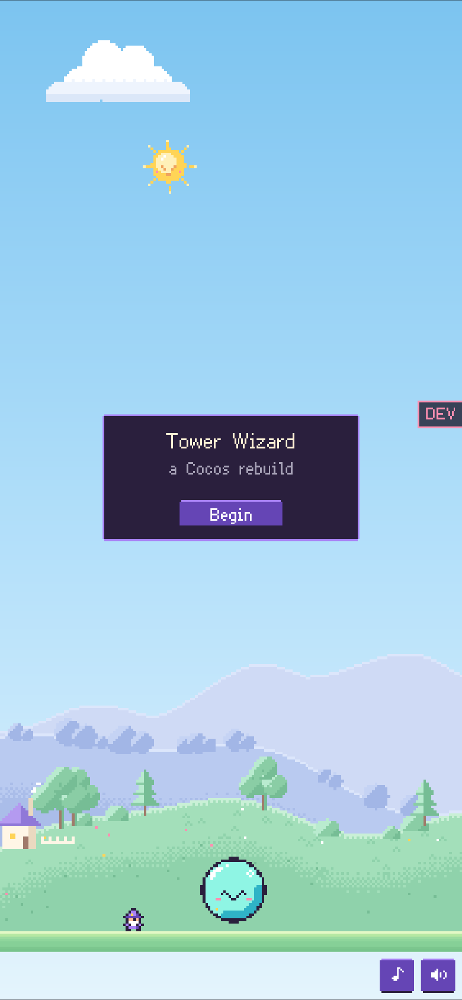
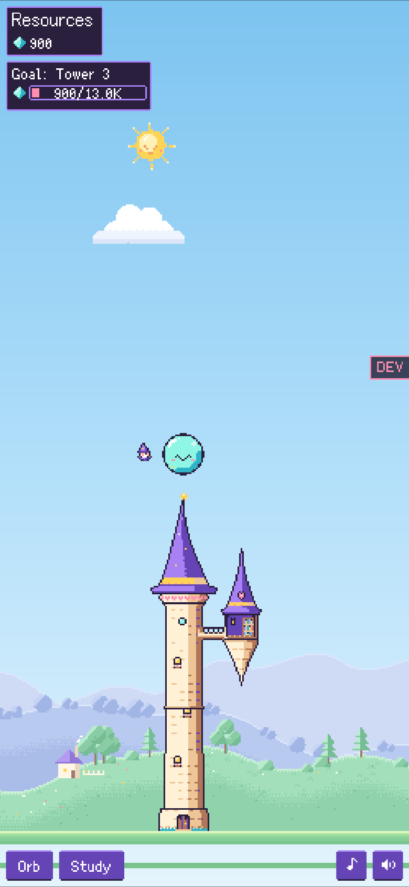
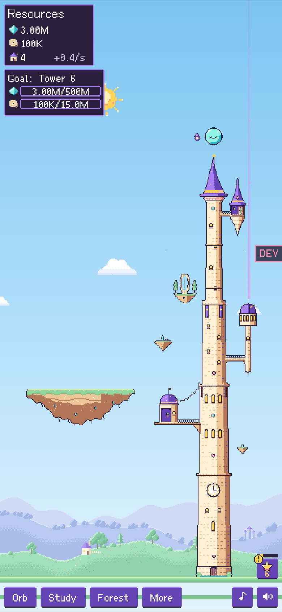
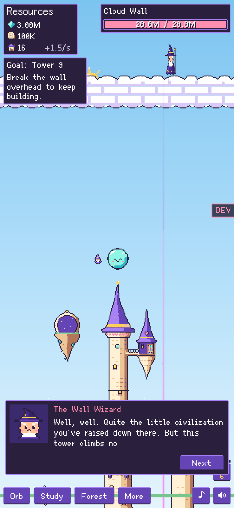
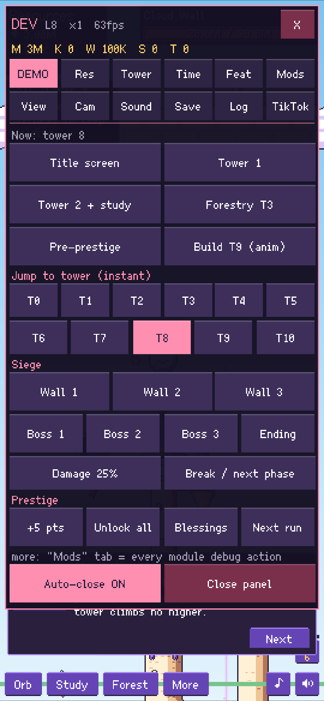

# Cozy Tower Idle

A portrait idle game for phones and TikTok Mini Games, built with Cocos Creator 3.8.8. You tap or swipe to pour magic into a smiling orb, grow a wizard tower one floor at a time, summon spirit helpers, and break through three sky walls to the finale.

**Play it:** [Claude artifact](https://claude.ai/artifact/TJRRJTR4Yznw4Xcn3hoZqs) (private for now, so the link only opens for its owner until it is shared).

| Title | Early tower | Mid game | Late game | Dev panel |
| --- | --- | --- | --- | --- |
|  |  |  |  |  |

Gameplay is modelled on the Steam game *Tower Wizard*. The art, music, sound effects and text in this repository are original. The original game's assets are not included.

## What is in it

- Towers 0 to 10, with resources, progress bars and an always-visible goal card for the next floor.
- Feature modules: siege walls and the Warden boss, prestige with 40 blessings, buildings, Academy, Embassy, dragons, alchemy, sorcery, runes, temple, observatory, obelisk and a day/night sky.
- Swipe-to-cast with particles, smooth pinch and scroll zoom, and a camera that never shows below the ground.
- Synthesized music and SFX (`audio-src/`) and a bitmap pixel font (Ark Pixel, OFL).
- A dev panel (the DEV tab on the right edge) for jumping to any tower, wall or boss. Add `?dev=0` to the URL to hide it.
- TikTok Minis integration in `assets/scripts/TikTokSDK.ts`: login, rewarded and interstitial ads, the home-screen shortcut and the profile-sidebar revisit task. Outside TikTok every call is simulated. The build passes `ttmg check` with no warnings.

## Build

Cocos Creator 3.8.8 builds from the command line without a Cocos account:

```bash
CocosCreator.exe --project <path-to-repo> --build "configPath=<path-to-repo>/build-web.json"
```

- `build-web.json` outputs `build/web-mobile`. Serve that folder over HTTP to play in a browser.
- `build-tiktok.json` outputs `build/bytedance-mini-game`, which also runs in the TikTok Minis runtime (`TTMinis.game`, `tt` and `wx` are the same API there). Set your App ID in `build-tiktok.json`, put your ad unit ids in `TT_CONFIG` in `TikTokSDK.ts`, then check the package with the official CLI:

```bash
npm install -g @ttmg/cli
```

```bash
ttmg check --dir build/bytedance-mini-game
```

## Tests

Logic tests run on Bun with a fake game host, without Cocos or a browser (about 1 second):

```bash
bun tools/testkit/run.ts
```

## Layout

- `assets/scripts/TowerWizardGame.ts` is the host: state, camera, UI, input and the tower build animation.
- `assets/scripts/modules/` holds one file per feature, registered through `GameModule.ts`.
- `assets/scripts/PixelDraw.ts` is an immediate-mode renderer on pooled sprite and label nodes.
- `assets/resources/art/` holds the sprites. Replace a file with one of the same name and size, then rebuild.
- `tools/` holds the build daemon, the test harness and the phone preview server.
